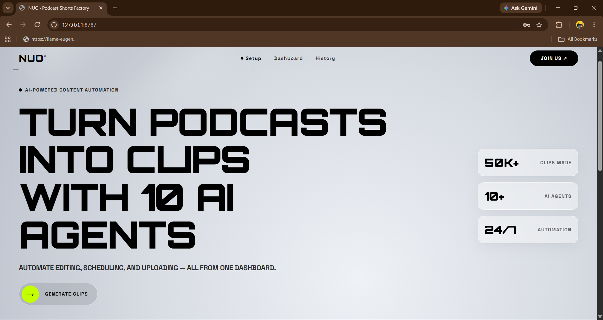
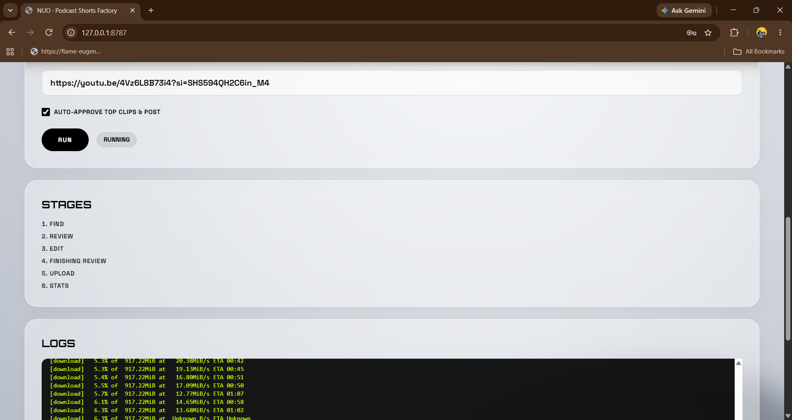
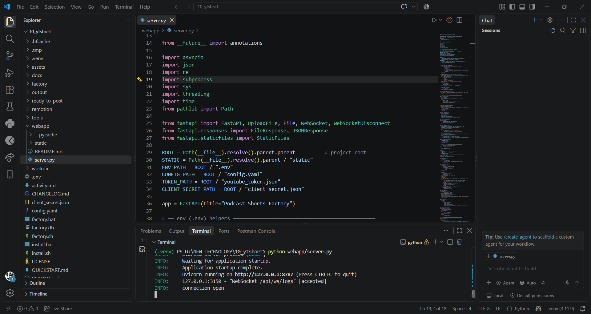
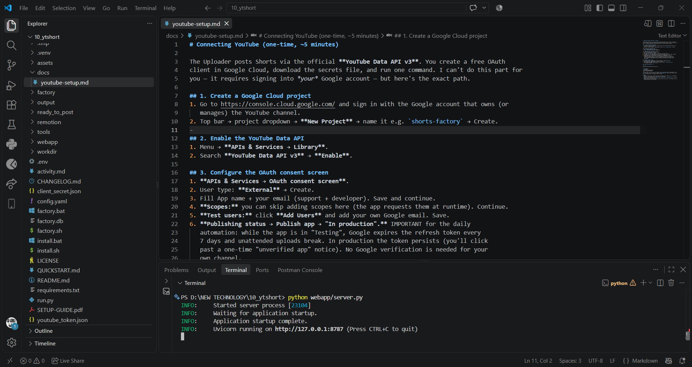

<div align="center">

# 🎬 Clipping Tool Free By AI
### Free AI Clipping Tool for GTA 6 (GTA VI), Podcasts & Long Videos → YouTube Shorts, TikTok & Reels

**Ten cooperating AI agents turn any long YouTube video into vertical Shorts — find the moments, edit, caption, quality-check and post. Free and open source.**

[](https://github.com/techakash32/Clipping-Tool-Free-By-AI/stargazers)
[](https://github.com/techakash32/Clipping-Tool-Free-By-AI/network/members)
[](https://github.com/techakash32/Clipping-Tool-Free-By-AI/issues)


`#GTA6` `#GTAVI` `#GTA6Clips` `#GTA6Gameplay` `#GTA6Trailer` `#YouTubeShorts` `#AIClipping` `#FreeClippingTool`

</div>

**🌐 Website:** https://techakash32.github.io/Clipping-Tool-Free-By-AI/ · **📚 Docs:** [QUICKSTART](QUICKSTART.md) · [YouTube setup](docs/youtube-setup.md)

---

## ⚡ TL;DR (Quick Answer)

**Clipping Tool Free By AI** (also called *Podcast Shorts Factory* and *NUO*) is a free, open-source, self-hosted **AI video clipping tool**. Give it a YouTube link — a GTA 6 gameplay stream, trailer breakdown, news video, podcast or interview — and it will:

1. Download and transcribe it locally (faster-whisper, word-level timestamps)
2. Use AI to score the most clip-worthy moments
3. Cut them to vertical **9:16**, with face tracking and animated captions
4. Add music, b-roll, punch zooms and effects
5. Quality-check every render
6. Write titles, descriptions and hashtags, then post to **YouTube Shorts**

It ships configured for **free AI providers** (OpenRouter, Groq, Gemini, Ollama), so you can run it at roughly zero cost. Run it from the command line or from the local web dashboard.

> Built with **Python + FastAPI + faster-whisper + ffmpeg + yt-dlp + YouTube Data API v3 + Remotion**. Runs on your own PC (Windows, macOS, Linux).

---

## 📸 Screenshots

| Dashboard Home | Run the Pipeline with Live Logs |
|---|---|
|  |  |

| Local Server Running | YouTube Setup Guide |
|---|---|
|  |  |

---

## 🎮 Why Use It for GTA 6 (GTA VI) Clipping?

GTA 6 content moves fast on YouTube Shorts, TikTok and Instagram Reels. Clippers who post first and post consistently win. This tool automates the slow parts:

- 🔥 Clip **GTA 6 trailer breakdowns, leak and news videos, theory podcasts and permitted gameplay streams**
- 🔥 **Vertical 9:16** output ready for Shorts, Reels and TikTok
- 🔥 **Trend Scout** agent searches the web for what's trending in your niche right now
- 🔥 **Hands-free mode**: schedule it daily and it finds, edits and posts on its own
- 🔥 Built-in **hashtag & SEO playbook** (`factory/skills/hashtags-seo.md`) — edit it with GTA 6 tags
- 🔥 **Free** — free AI providers, local transcription, free TTS, synthesized music

### GTA 6 clipping niches
| Niche | Example source video |
|---|---|
| Trailer breakdowns | Trailer analysis and reaction streams |
| Leaks & news | News channel videos, podcasts |
| Gameplay highlights | Your own captures or creators who allow clipping |
| Vice City / Leonida map talk | Community discussions |
| Lucia & Jason story theories | Theory podcasts |
| Funny moments | Streamer highlights (with permission) |

**To target GTA 6:** put GTA 6 channels or playlists you have permission to clip in `config.yaml` under `scheduler.sources`, and add the hashtag pack below to the hashtag skill file.

---

## 🤖 The 10 Agents

| # | Agent | What it does |
|---|-------|--------------|
| 1 | **Finder** | Downloads and transcribes the video, then uses AI to score the most clip-worthy moments. Long videos are scored in chunks so nothing is missed. |
| 2 | **Editor** | Cuts clips with ffmpeg, reframes to 9:16 with face tracking, burns in karaoke-style captions, mixes music, adds punch zooms, camera cuts, b-roll and a retention bar. |
| 3 | **Uploader** | Writes platform-specific titles, descriptions and hashtags, then uploads to YouTube Shorts via the official API. Can schedule a whole day server-side. TikTok and Reels are exported ready to post. |
| 4 | **Manager** | Pulls your real metrics (views, retention), works out what wins, and feeds learnings back to the Finder. |
| 5 | **Trend Scout** | Uses free web search to find what is trending in your niche. |
| 6 | **Planner** | Sets the hook text, music mood, emphasis words and effects placement for each clip. |
| 7 | **Community** | Drafts replies to comments on your posts. |
| 8 | **Finishing Editor** | Quality gate: catches captions covering faces, black or frozen frames, dead air, bad audio and wrong durations. Auto-fixes cheap problems and blocks broken clips. |
| 9 | **Trainer** | Weekly, studies top-performing Shorts in your niche and updates the craft playbook. |
| 10 | **Compiler** | Stitches the week's best moments into a long-form 16:9 episode with an AI-narrator editorial spine. |

On top of the agents there are **20+ skill playbooks** in `factory/skills/` (hooks, storytelling, pacing, sound design, captions, thumbnails, SEO, engagement, monetization). They are plain markdown — edit them freely.

---

## 🧠 Pipeline

```
FIND → REVIEW → EDIT → FINISHING REVIEW → UPLOAD → STATS
```

The dashboard shows each stage live, with streaming logs over WebSocket.

---

## 🚀 Quick Start

**Prerequisites:** Python 3.11+ and ffmpeg.

```powershell
winget install -e --id Python.Python.3.11
winget install -e --id Gyan.FFmpeg
```

**Install**
- Windows: double-click `install.bat`
- macOS / Linux: `bash install.sh`

The installer builds the environment, then launches a setup wizard (AI provider, API key, niche, platforms, call-to-action) and writes the config for you.

**Run from the command line**
```powershell
.\factory auto "https://www.youtube.com/watch?v=VIDEO_ID"
```
```bash
./factory.sh auto "https://www.youtube.com/watch?v=VIDEO_ID"
```

**Or use the web dashboard**
```bash
python webapp/server.py
```
Open 👉 **http://127.0.0.1:8787**, paste a YouTube link, tick **Auto-approve top clips & post** if you want hands-free posting, and click **RUN**.

**Fully unattended:** set your sources in `config.yaml` under `scheduler.sources`, then run `.\factory daily`.

More help: [`QUICKSTART.md`](QUICKSTART.md) · [`SETUP-GUIDE.pdf`](SETUP-GUIDE.pdf) · [`webapp/README.md`](webapp/README.md)

---

## 💸 It Runs Free

| Provider | Cost | Get a key |
|---|---|---|
| OpenRouter | free tier | https://openrouter.ai/keys |
| Groq | free | https://console.groq.com/keys |
| Google Gemini | free | https://aistudio.google.com/apikey |
| Ollama | free, local | https://ollama.com |
| Anthropic (Claude) | paid, best quality | https://console.anthropic.com |

Transcription runs locally with faster-whisper, voiceover uses free Edge TTS, and the music library is generated with pure synthesis.

---

## 🔗 Connect YouTube (one-time, ~5 minutes)

Uploads use the official **YouTube Data API v3**. Full walkthrough: [`docs/youtube-setup.md`](docs/youtube-setup.md)

1. Create a Google Cloud project and enable **YouTube Data API v3**
2. Configure the OAuth consent screen (External) and add your Google email as a test user
3. Publish the app **In production** so the refresh token doesn't expire every 7 days
4. Download `client_secret.json` into the project root
5. Run once and sign in — `youtube_token.json` is created automatically

> ⚠️ **Never commit** `.env`, `client_secret.json` or `youtube_token.json`.

---

## 🛠️ Commands

```
setup          First-run wizard (provider, key, niche, platforms, CTA)
find <url>     Download, transcribe, and AI-score clip candidates
review         Approve or reject candidates yourself
edit           Render approved clips into vertical shorts
finish         QA-review and finish each render before it can post
upload         Post or export to platforms
compile        Build the weekly long-form episode
stats          Refresh metrics and update learnings
scout          Refresh current trends
skills         List installed skills and which agent uses each
auto <url>     The whole pipeline in one command
daily          Fully unattended: trends, newest video, clips, edit, post
```

---

## 📁 Project Structure

```
├── factory/         # The 10 agents, config, DB, LLM layer, utils
│   ├── agents/
│   ├── skills/      # Markdown craft playbooks
│   └── utils/       # captions, faces, b-roll, trimmer, voice...
├── webapp/          # FastAPI server + dashboard (static/)
├── remotion/        # Remotion compositions (captions, intro hook)
├── tools/           # Music/SFX generators, scheduling scripts
├── assets/          # Screenshots and music
├── docs/            # YouTube setup guide
├── config.yaml
├── requirements.txt
├── install.bat / install.sh
├── factory.bat / factory.sh
└── run.py
```

---

## ❓ FAQ

**What is Clipping Tool Free By AI?**
A free, open-source tool made of ten AI agents that turns long YouTube videos into vertical short-form clips and can post them to YouTube Shorts automatically.

**Is it really free?**
The code is MIT-licensed and runs on your own computer. Default settings use free AI providers; you only need your own free Google Cloud OAuth credentials for YouTube uploads.

**Can I use it for GTA 6 clipping?**
Yes. Point it at GTA 6 / GTA VI videos you have the right to clip — trailer breakdowns, news, theory podcasts, your own gameplay — and it will produce Shorts-ready clips.

**Does it work for podcasts?**
Yes. It started as *Podcast Shorts Factory* and works on any talk-heavy or highlight-heavy long video.

**Which platforms can it post to?**
YouTube Shorts is automated. TikTok and Instagram Reels clips are exported ready to post manually.

**Which operating systems are supported?**
Windows, macOS and Linux with Python 3.11+ and ffmpeg.

**Do I need a GPU?**
No. A GPU can speed up transcription but isn't required.

**Is it OK to clip other people's videos?**
Only clip content you own, are licensed to use, have permission for, or that qualifies as fair use where you live. See the responsibility note below.

---

## 🔥 GTA 6 Hashtag Pack (Copy & Paste)

**Core** — `#GTA6` `#GTAVI` `#GrandTheftAutoVI` `#GTA6Trailer` `#GTA6Gameplay` `#GTA6News` `#GTA6Leaks` `#GTA6Update`

**Clipping & Shorts** — `#GTA6Clips` `#GTA6Shorts` `#GTA6Edit` `#GTA6Reels` `#GTA6TikTok` `#GTA6Moments` `#GTA6Funny` `#GTA6Reaction` `#GTAClips` `#GamingClips`

**World & Characters** — `#ViceCity` `#Leonida` `#LeonidaFlorida` `#Lucia` `#Jason` `#GTA6Map` `#GTA6Story` `#GTA6Theory`

**Platform / Brand** — `#RockstarGames` `#PS5` `#XboxSeriesX` `#NextGenGaming` `#OpenWorld` `#GamingNews`

**Creator Growth** — `#YouTubeShorts` `#Shorts` `#ShortsFeed` `#ViralShorts` `#ContentCreator` `#Clipper` `#ClippingTool` `#AIClipping` `#AIVideoEditor` `#FreeTool` `#OpenSource`

**Ready-to-use sets**
```
#GTA6 #GTAVI #GTA6Clips #GTA6Gameplay #GTA6Trailer #ViceCity #RockstarGames #YouTubeShorts #Shorts #Gaming
```
```
#GTA6Leaks #GTA6News #GTA6Theory #Lucia #Jason #LeonidaFlorida #ViralShorts #GamingNews #ShortsFeed #Clipper
```

**Title templates**
- `GTA 6 Trailer Detail Nobody Noticed 😱 #GTA6 #Shorts`
- `This GTA 6 Leak Changes Everything #GTAVI #GTA6Leaks`
- `GTA 6 Vice City Is INSANE 🔥 #GTA6 #ViceCity`
- `Lucia & Jason Theory — Is This Real? #GTA6Theory`

---

## 🔍 Search Keywords

free AI clipping tool · GTA 6 clipping tool · GTA VI clip maker · GTA 6 shorts generator · free video clipper · AI video clipper · YouTube Shorts generator · long video to shorts · podcast to shorts · auto clip YouTube video · AI shorts maker · open source clipping tool · OpusClip alternative free · automatic YouTube Shorts uploader · Python video clipper · multi-agent video automation · GTA 6 trailer clips · GTA 6 gameplay clips · vertical video converter · content repurposing tool

---

## 🌍 Who Is This For?

- 🎮 GTA 6 clippers and gaming channels
- 🎙️ Podcast clip channels
- 📺 Streamers repurposing VODs
- 🧑‍💻 Creators wanting a free OpusClip / Vizard alternative
- 🤖 Developers exploring multi-agent video automation

---

## 🗺️ Roadmap & Contributing

Good places to start:

- Gameplay-specific moment detection (chases, explosions, funny fails)
- Direct TikTok and Instagram Reels posting
- More editor styles and transitions
- Better clip-selection prompts in `config.yaml` and `factory/skills/`
- More checks in the Finishing Editor

Fork → branch → commit → pull request. [Open an issue](https://github.com/techakash32/Clipping-Tool-Free-By-AI/issues) with ideas.

⭐ **If this helps you, please star the repo — it helps more clippers find it.**

---

## ⚠️ Please Use It Responsibly

This automates production, not judgement. Only clip content you have the rights to. You are responsible for platform rules and any API costs. Fully automated posting can attract strikes if you are careless — the default config posts publicly, so consider setting `privacy: "private"` in `config.yaml` first, watch what it produces, then go public.

This is an **independent, unofficial project**, not affiliated with or endorsed by Rockstar Games, Take-Two Interactive, or YouTube/Google. *Grand Theft Auto* and *GTA VI* are trademarks of their respective owners.

It is not perfect: output quality varies and there are rough edges. Every fix, idea and pull request helps.

---

## 📄 License

MIT — see [LICENSE](LICENSE). Use it, change it, sell it, have fun.

<div align="center">

**Made by [@techakash32](https://github.com/techakash32)**

`#GTA6` `#GTAVI` `#AIClipping` `#YouTubeShorts` `#OpenSource` `#FreeTool`

</div>
